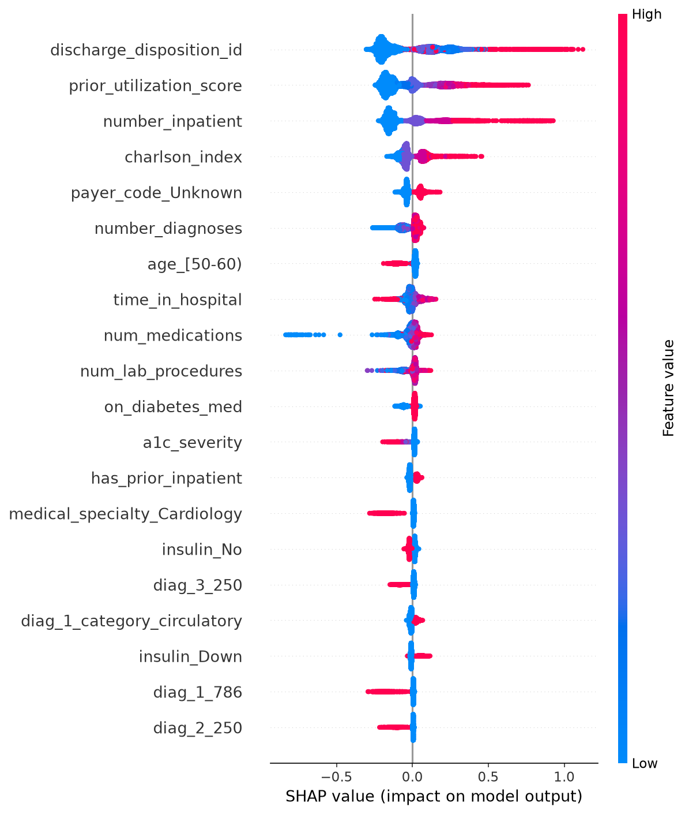

# Hospital Readmission Prediction System

A production-ready, end-to-end Machine Learning and Healthcare Data Science project to predict 30-day hospital readmissions, understand patient risk trajectories, and empower clinical teams with actionable insights.

---

## 📋 Table of Contents
1. [Implementation Status](#-implementation-status)
2. [Project Overview & Problem Statement](#-project-overview--problem-statement)
3. [Domain & Clinical Significance](#-domain--clinical-significance)
4. [Data Collection & Dataset Attributes](#-data-collection--dataset-attributes)
5. [Data Preprocessing & Cleaning](#-data-preprocessing--cleaning)
6. [Exploratory Data Analysis (EDA)](#-exploratory-data-analysis-eda)
7. [Feature Engineering & Domain Indicators](#-feature-engineering--domain-indicators)
8. [Model Training, Evaluation & Interpretability](#-model-training-evaluation--interpretability)
9. [System Design & API Architecture](#-system-design--api-architecture)
10. [LLM & Generative AI Integration](#-llm--generative-ai-integration)
11. [Cloud Deployment Strategy](#-cloud-deployment-strategy)
12. [Repository Structure](#-repository-structure)
13. [Installation & Quickstart Guide](#-installation--quickstart-guide)
14. [Compliance & Clinical Disclaimer](#-compliance--clinical-disclaimer)

---

## 🚧 Implementation Status

| Component | Status | Location |
|---|---|---|
| Data loader & Preprocessing | ✅ Implemented | `src/data/` |
| Feature engineering (Charlson, prior utilization) | ✅ Implemented | `src/features/build_features.py` |
| Model training (LogReg, XGBoost, LightGBM) | ✅ Implemented | `src/models/train.py` |
| Explainability (SHAP TreeExplainer) | ✅ Implemented | `src/models/train.py` & `src/api/main.py` |
| FastAPI service (Predict & Explain) | ✅ Implemented | `src/api/main.py` |
| LLM summarizer (Ollama + Mock fallback) | ✅ Implemented | `src/llm/summarizer.py` |
| CI/CD (Pytest + GitHub Actions) | ✅ Implemented | `.github/workflows/ci_cd.yaml` |
| Docker Containerization | ✅ Implemented | `Dockerfile` |

---

## 🏥 Project Overview & Problem Statement

Hospital readmission within 30 days of discharge is a critical quality and financial indicator in modern healthcare. Unplanned readmissions often point to incomplete recovery, post-discharge complications, or gaps in transition of care.

### Core Objectives:
- **Risk Identification**: Predict the likelihood of an inpatient being readmitted within 30 days post-discharge.
- **Root Cause & Factor Analysis**: Understand why a patient who appeared well at discharge deteriorates and requires hospital re-entry.
- **Decision Support**: Provide healthcare providers with interpretable risk scores and automated clinical summaries to formulate timely intervention plans.

---

## 🩺 Domain & Clinical Significance

- **Patient Outcomes**: Early identification allows targeted discharge planning, timely medication reconciliation, and scheduled home health visits.
- **Healthcare Economics**: Under programs like the Hospital Readmissions Reduction Program (HRRP), hospitals face significant penalties for excess readmissions.
- **Care Coordination**: Bridges the critical window between inpatient discharge and primary care follow-up.

---

## 📊 Data Collection & Dataset Attributes

### Data Sources
- **UCI Machine Learning Repository**: [Diabetes 130-US Hospitals Dataset (1999–2008)](https://archive.ics.uci.edu/dataset/296/diabetes+130-us+hospitals+for+years+1999-2008).

### Key Clinical & Demographic Features
- **Demographics**: Age group, Gender, Race/Ethnicity.
- **Admission & Encounter Details**: Admission type, source, Length of Stay (LOS).
- **Clinical History**: Prior outpatient, emergency, and inpatient visits.
- **Diagnoses**: Primary, secondary, and additional ICD-9 diagnosis codes.
- **Diagnostics**: Lab procedures, glucose tests, HbA1c results.
- **Medications**: Number of medications, changes in medications, insulin management.
- **Target Variable**: Readmission status (`<30`, `>30`, `NO`).

---

## 🧹 Data Preprocessing & Cleaning

1. **Missing Data Handling**: 
   - Imputed clinical variables using domain-aware strategies (explicit `"Unknown"` categories where "not measured" is clinically meaningful).
   - Dropped features with excessive sparsity (>50% missing, e.g., `weight`).
2. **Hospice & Death Filtering**:
   - Excluded encounters ending in death or hospice (`discharge_disposition_id` ∈ {11, 13, 14, 19, 20, 21}). This removes **2,423 encounters (2.38%)** that are mathematically impossible to readmit.
3. **Leakage Prevention**:
   - Used a **patient-grouped split** (`GroupShuffleSplit` by `patient_nbr`) to ensure no patient appears in both train and test sets.
   - Test set contains **only the first index encounter** per patient to mimic true cold-start production deployment.
4. **Encoding & Scaling**:
   - `ColumnTransformer` applies One-Hot Encoding to categories and Standard Scaling to numerical features. It is fit **only on the training split** and saved as `preprocessor.joblib` to guarantee train/serve parity.

---

## 🔍 Exploratory Data Analysis (EDA)

*(See `notebooks/01_data_exploration_eda.ipynb` for full visualizations)*
- **Target Distribution**: Proved class imbalance (11.2% positive rate for `<30` days).
- **Demographic Disparities**: Visualized U-shaped readmission risk across age brackets.
- **Clinical Validity**: Plotted the direct correlation between our engineered `charlson_index` and `prior_utilization_score` against readmission rates.

---

## ⚙️ Feature Engineering & Domain Indicators

- **Charlson Comorbidity Index**: Mapped ICD-9 diagnosis codes to established clinical weights.
- **Prior Utilization Index**: Weighted score of historical admissions (`IP * 3 + ED * 2 + OP * 1`).
- **Polypharmacy Indicator**: Binary flags for patients prescribed ≥5 or ≥10 concurrent medications.
- **Diagnostic Complexity**: Total distinct diagnoses divided by length of stay.
- **Glycemic Control Fluctuation**: Interaction term between HbA1c severity, insulin adjustments, and LOS.

---

## 🤖 Model Training, Evaluation & Interpretability

### Model Candidates
We trained and benchmarked:
- **Logistic Regression** (Baseline): PR-AUC `0.1987`
- **LightGBM**: PR-AUC `0.2152`
- **XGBoost** (Winner): PR-AUC `0.2152`, ROC-AUC `0.6613`

*XGBoost was selected as the champion model due to its balanced precision-recall performance and tree-based explainability.*

### Explainability (SHAP)
Using `shap.TreeExplainer`, we can explain both globally and locally. The top predictive features were prior inpatient visits, Charlson Index, and discharge disposition.


*SHAP summary showing feature impact on readmission risk.*

---

## 🏗️ System Design & API Architecture

```
                 [ Electronic Health Record (EHR) / Client ]
                                    │
                                    ▼
                  [ FastAPI Microservice (src/api/main.py) ]
                ┌───────────────────┴─────────────────────┐
                ▼                                         ▼
      [ Preprocessing Pipeline ]                [ Pydantic Validation ]
                │
                ▼
  [ Model Server (XGBoost .joblib) ]
                │
                ├───► [ Prediction & Risk Score Engine ]
                │
                ▼
[ LLM Explainer Service (Ollama / Mock) ]
```


### REST API Endpoints
- `GET /health`: Service health and model version check.
- `POST /v1/predict`: Single patient real-time readmission risk scoring.
- `POST /v1/explain`: Returns top SHAP attribution values and generated clinical summary.

---

## 🧠 LLM & Generative AI Integration

To bridge the gap between raw numbers and clinical action, we integrated a robust LLM summarizer (`src/llm/summarizer.py`).
- **Local Ollama Support**: If `ollama run llama3` is active, the API generates highly contextual narratives.
- **Resilient Fallback**: If Ollama is offline, the service falls back to a deterministic, rule-based template. This ensures the API never crashes during clinical operations.

---

## ☁️ Cloud Deployment Strategy

While currently running locally via Docker, the architecture is designed for:
- **AWS**: ECS (Fargate) hosting the API, S3 for `.joblib` artifacts, CloudWatch for drift monitoring.
- **GCP**: Google Cloud Run for serverless container execution, Vertex AI for automated retraining pipelines.

---

## 📁 Repository Structure

```text
hospital-readmission-prediction/
├── assets/                     # Images for documentation (SHAP plots)
├── config/                     # Hyperparameters (.yaml)
├── data/                       # Raw and processed datasets (gitignored)
├── notebooks/                  # EDA and benchmarking Jupyter notebooks
├── src/
│   ├── data/                   # Loader and preprocessor pipelines
│   ├── features/               # Clinical feature engineering
│   ├── models/                 # Training, inference, and SHAP logic
│   ├── llm/                    # Ollama summarization layer
│   └── api/                    # FastAPI application and schemas
├── tests/                      # Pytest API integration tests
├── Dockerfile                  # Multi-stage container build
├── requirements.txt            # Production dependencies
└── pytest.ini                  # Test configuration
```

---

## 🚀 Installation & Quickstart Guide

### 1. Clone & Set Up Virtual Environment
```bash
git clone https://github.com/RyoHaradaps/hospital-readmission-prediction.git
cd hospital-readmission-prediction
python3 -m venv venv
source venv/bin/activate    # On Windows: venv\Scripts\Activate.ps1
pip install -r requirements.txt
```
2. Download the Dataset
Download the UCI Diabetes 130-US Hospitals dataset from:
https://archive.ics.uci.edu/dataset/296/diabetes+130-us+hospitals+for+years+1999-2008

Extract and name it, then place ```diabetic_data.csv``` into ```data/raw/```.

### 2. Run Data Pipeline & Model Training
```bash
python -m src.data.preprocessor
python -m src.features.build_features
python -m src.models.train
```

### 3. Launch the Prediction API Server
```bash
uvicorn src.api.main:app --host 0.0.0.0 --port 8000 --reload
```
Interactive Swagger API docs available at: `http://localhost:8000/docs`

### 4. Build and Run via Docker
```bash
docker build -t hospital-readmission-api:v1 .
docker run -p 8000:8000 hospital-readmission-api:v1
```

---

## 📜 Compliance & Clinical Disclaimer
*This system is intended for research, decision support, and operational workflow enhancement. Predictions must be verified by licensed medical professionals and are not intended to replace clinical judgment.*

*Model outputs do not constitute medical advice. Any deployment in a clinical setting requires IRB review, HIPAA compliance validation, prospective validation on local patient cohorts, and continuous monitoring for demographic bias and calibration drift.*
